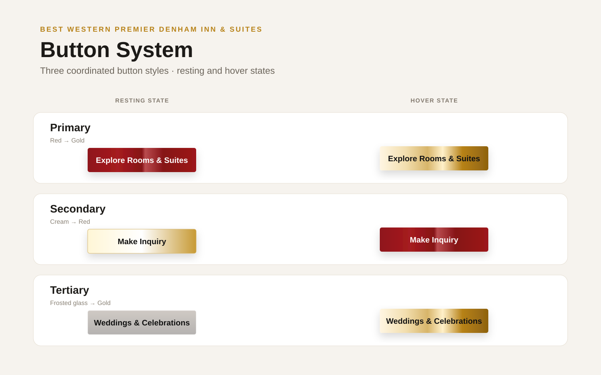

# Best Western Premier Denham Inn & Suites

<https://www.bestwesterndenham.com/>

## Project overview

Website design, development, content, SEO, technical customization, and ongoing management for Best Western Premier Denham Inn & Suites in Leduc, Alberta.

This project is part of a broader multi-property hospitality website portfolio for Denham Hospitality Organization (DHO).

## My responsibilities

- Designed and built the website using Squarespace 7.1.
- Developed page layouts and organized website content around the property and its guest services.
- Wrote original website copy and supporting content.
- Created and refined SEO content, page titles, and metadata.
- Customized presentation and interaction states using CSS and HTML.
- Implemented and refined JSON-LD / Schema.org structured data.
- Manage and maintain the website over time.

## Homepage design

The homepage brings several parts of the guest experience together in one long-form page:

- A prominent photographic hero with a short brand-led welcome message.
- An introductory section that directs visitors toward dining, meetings, and celebrations.
- A trust and review element.
- Event and group hospitality content with image-led category links.
- Guest room and suite options.
- Food, beverage, and on-site amenity highlights.
- Promotional and editorial content, FAQs, newsletter signup, and contact details.

The layout uses alternating light neutral sections, photography, concise text blocks, and repeated calls to action to help visitors scan the range of hotel offerings.

## Custom CSS: interactive button system

A significant part of my custom CSS work is a coordinated button system that gives the site's calls to action a distinctive, polished interaction.

The system has three styles:

- **Primary:** layered Denham-red satin gradient at rest, transitioning to champagne / gold with dark text on hover or keyboard focus.
- **Secondary:** pearl cream / champagne gradient at rest, transitioning to the red satin treatment with light text.
- **Tertiary:** translucent frosted-glass treatment over photographic tiles, transitioning to champagne / gold.

The shared interaction layer adds a short transition, a 4px vertical lift, and a stronger layered shadow. The gradient background position animates to create the satin / brushed-metal finish. The tertiary treatment also uses a subtle pseudo-element sheen.

### Portfolio demonstration

- **[View the interactive button-system demo](../../technical-examples/custom-css/denham-button-system.html)** — compare the resting and hover states or test the live buttons.
- **[View the reusable CSS](../../technical-examples/custom-css/denham-button-system.css)**
- **[View the custom CSS showcase documentation](../../technical-examples/custom-css/README.md)**

The comparison graphic is a designed visual reference based on the supplied CSS. The interactive page contains live CSS examples; neither is presented as a screenshot captured from the production site.

## Other CSS refinements

The master stylesheet also includes targeted refinements for:

- Link hover and visited states, while preventing button links from inheriting ordinary text-link underlines.
- Gold inline checkmarks and clean wrapping in selected rich-text / HTML-block lists.
- Rounded image corners across selected blog, summary, gallery, and carousel media.
- Footer newsletter width, spacing, field sizing, and button sizing.
- Mobile navigation menu colors.
- Hero introduction list spacing.

These adjustments are scoped to selected Squarespace elements rather than replacing the platform's underlying content system.

## Content strategy & copywriting

Original page copy and content organization support the hotel's accommodation, dining, meetings, events, and other guest-facing information. The homepage acts as a starting point, directing visitors to more detailed pages and relevant calls to action.

## Technical SEO, structured data & AI discoverability

- **Keyword-led URL structure.** Pages use descriptive, location-specific slugs such as `/weddings-venue-leduc`, `/hotel-near-edmonton-international-airport` and `/group-room-blocks`. Older generic URLs (`/stay`, `/dine`, `/meet`, `/about-1`) are 301-redirected to their new pages, so existing links and search equity carry over.
- **Unique titles and meta descriptions** on every core page, written around the searches each page serves (for example "Wedding Venues in Leduc, Alberta" and "Group Room Blocks | Sports Teams & Large Groups Leduc").
- **Hand-written, connected JSON-LD** layered on top of Squarespace's defaults: an `@graph` linking Denham Hospitality → the `Hotel` (logo, photo, contact, social profiles, Best Western brand, amenities) → O'Brian's (`Restaurant`) and Jonathan's (`BarOrPub`), plus `Service` entities for weddings and meetings and an `FAQPage` with 127 questions. Validates with 0 errors and 0 warnings. [View the schema and entity map](../../technical-examples/structured-data/).
- **Full-site technical audit:** crawled all 79 pages and 157 unique links, then fixed 8 broken links (re-crawl: 0 broken), extra H1s, 21 missing alt-text descriptions, page-title formatting and indexable tag archives. [View the audit and code](../../technical-examples/technical-seo/).
- **`llms.txt` for AI answer engines.** A curated Markdown summary at [/llms.txt](https://www.bestwesterndenham.com/llms.txt) that gives AI assistants the hotel's verified facts and key pages, kept consistent with the structured data. `robots.txt` was checked to confirm AI crawlers are permitted. [View the file and notes](../../technical-examples/ai-discoverability/).
- **Canadian locale** (`lang="en-CA"`), self-referencing canonical URLs and an XML sitemap.
- **Direct-revenue paths** built into the page structure: a deep link into the Best Western booking engine for this property, Toast online ordering for Jonathan's Lounge, and dedicated group and event inquiry pages.

## Project context

The website represents one property within a group of hospitality businesses. Its digital experience needs to communicate the individual hotel's identity while fitting into a wider multi-property ecosystem.

## Skills demonstrated

Squarespace 7.1 · Website design · Website development · Content strategy · Copywriting · On-page and technical SEO · URL architecture & 301 redirects · Metadata · CSS · HTML · JSON-LD · Schema.org · llms.txt / AI discoverability · Responsive refinements · Website management

Only publish screenshots, code, and business materials that are approved for portfolio use. Remove credentials, private contact details, and confidential information.
