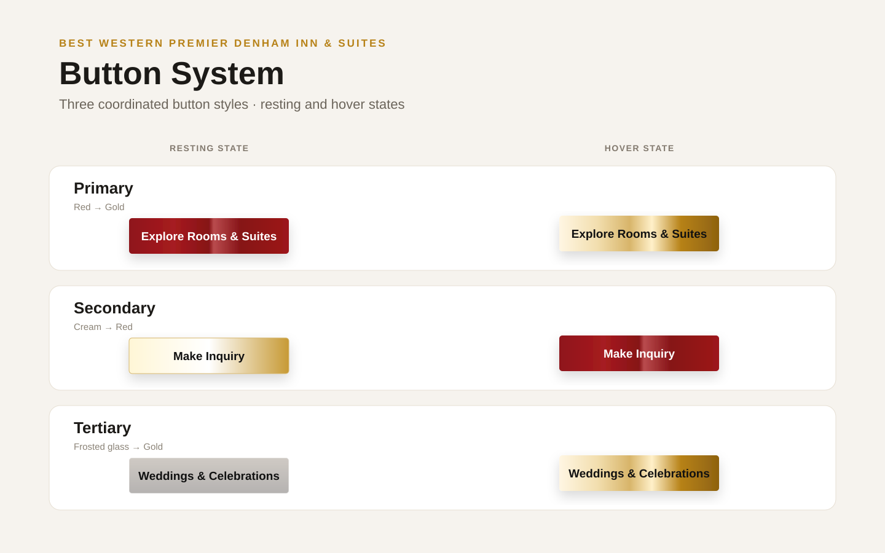

# Custom CSS — Squarespace 7.1

This section documents selected front-end styling work for the Best Western Premier Denham Inn & Suites website.

## Interactive button-system showcase

The button system has three coordinated visual treatments:

| Button type | Resting appearance | Hover / keyboard-focus appearance |
|---|---|---|
| Primary | Layered Denham-red satin gradient with light sheen | Champagne / gold gradient with dark text |
| Secondary | Pearl cream / champagne gradient with a fine gold edge | Denham-red satin gradient with light text |
| Tertiary | Translucent frosted-glass treatment over image tiles | Champagne / gold gradient with dark text |

**[Open the interactive button-system demonstration](denham-button-system.html)**

The demonstration includes side-by-side resting and hover samples, plus live buttons that can be hovered or reached with a keyboard. The hover samples use a demo-only class so the visual state can be shown in a static comparison without a cursor.

## Button behavior and styling

- Shared sizing, typography, border radius, transitions, and layered shadows.
- A 4px upward lift and stronger shadow on hover or keyboard focus.
- Animated gradient positioning to create the satin / brushed-metal effect.
- Primary buttons transition from red to gold.
- Secondary buttons transition from cream / gold to red.
- Tertiary buttons transition from translucent white over photography to gold, with a subtle sheen overlay.
- Keyboard focus uses the same visual treatment as hover.

## Source files

- [Interactive HTML demonstration](denham-button-system.html)
- [Reusable button CSS](denham-button-system.css)
- [Static state-comparison graphic](button-state-comparison.svg)

The standalone HTML page is a portfolio demonstration. Its live examples link to public pages on the hotel website; its comparison states are rendered samples rather than screenshots of the production site.

## Additional CSS refinements

The broader master stylesheet also includes targeted refinements for selected Squarespace components:

- Link and footer-link behavior.
- Rich-text / HTML-block checklists with inline gold checkmarks.
- Rounded corners on selected image, gallery, summary, and carousel media.
- Footer newsletter spacing and field dimensions.
- Mobile menu colors.
- Hero introduction list spacing.

## Implementation notes

The button rules are written as reusable CSS classes and can be adapted to Squarespace 7.1 elements. The standalone demonstration uses plain HTML and CSS to make the visual states easy to inspect. This is front-end styling customization, not a JavaScript application or a replacement for Squarespace platform functionality.

The HTML demonstration includes a small JavaScript view toggle; the button styling and hover transitions themselves are CSS.

## Portfolio publishing

Publish only code and business materials that you authored or are authorized to share. Review future examples for credentials, internal identifiers, private URLs, and confidential information.
